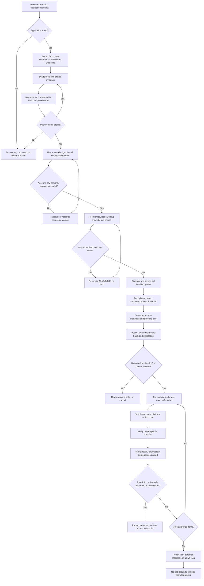

# Platform Workflow

## Manual access and capability checks

The user signs into the job-seeker account manually, handles verification/CAPTCHA, and chooses/uploads the resume. Never ask for or enter credentials or one-time codes. Use official job-seeker entry points; do not assume a registration/advertising landing page is the job-seeker interface. Confirm account, selected city, and exact uploaded resume version. If ambiguous or unavailable, pause for the user. Do not upload or change a resume unless explicitly authorized.

Before starting a batch, initialize/validate the external data path and recover prior state as described in `ledger-schema.md`. If the directory is unwritable, lock unavailable, incomplete event reconciliation exists, or batch/message hashes cannot be verified, do not search, filter, or send.

## Screen and prepare

Read the complete job description and record the exact employer, role, city, salary as listed, URL, requirements, evidence, gaps, and action. Screen employer identity, opening activity, fit, and risk separately using `screening-and-evidence.md`. Do not click apply/communicate during discovery. Create a candidate ledger row and stable `candidate_id`; apply same-platform/cross-platform deduplication before preparing a batch.

Prepare up to 150 qualifying openings per platform; the number is a ceiling, not a quota. Do not relax filters. For each accepted candidate choose only project evidence supported by the resume. Build an immutable manifest and exact greeting file/hash where applicable. Show a summary expandable to every candidate and action, including exceptions. Ask for explicit confirmation naming batch ID, batch hash, count, resume version, and platform actions. Any material change requires a new manifest and renewed confirmation.

## Execute one approved action at a time

For each item, check the visible employer, role, city, and platform action against the approved manifest immediately before acting. Follow the durable write-ahead protocol in `ledger-schema.md`: persist intent before any click; execute once; verify observable result; persist result; write the attempt row; recompute the deduplication index. If a step or durable write fails, pause. Never click the next item while recovery or an uncertain result is unresolved.

### BOSS直聘

Send exactly one user-approved, role-specific greeting using the exact saved text whose hash matches the manifest. Do not attach a resume, send a second message, or continue the conversation automatically. Visible success evidence is a real outgoing message bubble or a sent record attributable to the target conversation. Empty input, a disabled button, loading state, or timeout alone is not success.

### 智联招聘

Submit the user's already-uploaded resume version confirmed for the batch. Do not invent a greeting; `action=resume_delivery` uses `message_hash: null` and no message file. Verify a visible application record or other attributable platform receipt. An incomplete form, loading state, or button change alone is not success.

## Outcome and stop rules

Use `sent_confirmed` only with visible target-specific evidence; use `failed` only when the page confirms the action did not occur; otherwise record `unverified`. A greeting bubble or application record must match the approved job, not merely the same employer. Do not infer success from input clearing, button state, or page appearance alone.

Stop the affected queue immediately on CAPTCHA, rate-limit/frequency warning, account anomaly/login expiry, target/page mismatch, duplicate warning, unclear submission behavior, unexpected data request, or durable storage failure. Store only the reason code, not page/chat text. Do not bypass controls or retry an uncertain attempt. Tell the user what needs attention. A response analyst may classify conversations only during the authorized active task, cannot reply to recruiters, and must not copy recruiter message text into records. No background polling after the task ends.

## Interrupt and resume

Persist `queue_position` after each reconciled candidate. On resumption, first complete log/ledger/contacted reconciliation and cleanup-plan recovery. Then verify: (1) same account identity, (2) same city/filter controls, (3) selected uploaded resume matches the confirmed manifest, and (4) last attempted item has a resolved send state. An `unverified` item is not retried; inspect the actual conversation/application record and append a valid resolution or ask the user. Resume only from the first still-approved, unattempted item. If visible page behavior no longer matches the recorded evidence pattern, stop and request review rather than guessing.

## End-to-end flow

