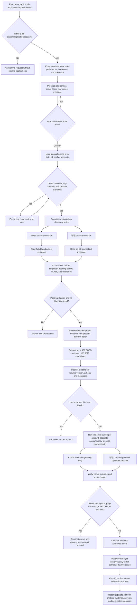

# Platform Workflow

## Human login and entry points

The user manually signs into the job-seeker account and handles CAPTCHA, account recovery, and verification prompts. Do not use stored credentials or automate login.

Use official entry points and select the confirmed city in the platform UI. Avoid hard-coded city paths (for example, a Shenzhen-specific BOSS URL) when the user's confirmed target city differs. A registration/advertising landing page is not assumed to be a job-seeker page; verify the visible site and account role before proceeding. Do not create accounts, change account identity, or upload a resume unless explicitly authorized.

Confirm that the resume currently selected on 智联 is the version the user approved. If the resume is unavailable or ambiguous, pause for the user.

## Platform actions

### BOSS直聘

For each approved role:

1. Confirm the visible employer, job title, and city match the ledger entry.
2. Confirm the control performs one initial communication action.
3. Send one short, role-specific greeting using only supported resume facts.
4. Do not attach/submit a resume through the greeting, send a second message, or continue the conversation automatically.
5. Verify the platform visibly records the greeting as sent; otherwise mark uncertain and inspect before retrying.

### 智联招聘

For each approved role:

1. Confirm the visible employer, job title, city, and application form match the ledger entry.
2. Confirm the selected, already-uploaded resume is the version shown in the approved batch.
3. Submit the application with that resume. Do not add unapproved attachments, answers, salary claims, or personal details.
4. Verify the platform visibly records successful submission; otherwise mark uncertain and inspect before retrying.

## Detailed end-to-end diagram

## User communication

Keep messages concise. Normally ask for only two confirmations: (1) the search profile, and (2) the exact batch and platform actions. Send brief progress only when a user decision or intervention is needed, then provide one final report. Do not hide a material issue in the name of minimizing chatter.
